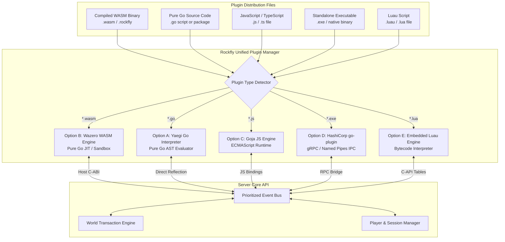

# Plugin Architecture & Extensibility for Rockfly
## Technical Evaluation of Zero-Dependency Plugin Systems in Go

---

## 1. The Core Engineering Challenge

In Minecraft Java server software (Paper, Spigot, Bukkit), plugins are distributed as compiled Java Bytecode (`.jar` files). Because the Java Virtual Machine (JVM) dynamically loads class files at runtime across any operating system, building a plugin loader in Java is trivial (`URLClassLoader`).

In Go, however, applications compile directly to native machine code (`.exe` on Windows, ELF on Linux, Mach-O on macOS). This presents a fundamental architectural challenge for server software that aims to be **easily runnable by normal users without external dependencies**.

### Why Go's Native `plugin` Package Cannot Be Used:
Go includes a built-in `plugin` package (`plugin.Open`), but it has critical limitations that make it unsuitable for production:
1. **Zero Windows Support**: The standard library `plugin` package **does not work on Windows at all**. Calling `plugin.Open()` on Windows immediately returns an unsupported error.
2. **Brittle Binary Coupling**: On Linux and macOS, both the server and the plugin must be built with the **exact same Go compiler version**, the **exact same dependency versions**, and the **exact same build flags**. A single discrepancy results in an instant runtime panic (`plugin was built with a different version of package...`).
3. **End-User Toolchain Friction**: Requiring users or server owners to install the Go compiler toolchain, configure environment variables, and compile plugins locally violates our core principle of making Rockfly effortless to run.

---

## 2. The 5 Zero-Dependency Plugin Architectures

To deliver a true Paper-grade plugin experience—where users simply download a plugin file, drop it into the `plugins/` directory, and start the server—we have evaluated the five proven approaches used in modern Go systems.

---

### Option A: Dynamic Pure Go Scripting via `yaegi` (Embedded Go Interpreter)
- **Engine**: [`traefik/yaegi`](https://github.com/traefik/yaegi) (used by Traefik for dynamic middleware plugins).
- **How It Works**:
  - Yaegi is an in-memory Go interpreter written entirely in pure Go (`CGO_ENABLED=0`).
  - Plugin authors write **standard Go code** (`.go` files or multi-file Go packages).
  - When the server boots, Rockfly parses and interprets the Go code in memory at runtime without invoking `go build` or requiring Go on the user's computer.
- **Developer Experience**:
  - Extremely natural for Go developers: plugins look identical to standard Dragonfly packages.
  - Native access to types, structs, and methods exported by Rockfly.
- **Strengths**:
  - Zero toolchain required for end users.
  - 100% native Go syntax and standard library support.
- **Trade-offs**:
  - Performance: Interpreted Go is roughly $5\times$ to $10\times$ slower than native compiled code. Excellent for event listeners, commands, and chat rules; slower for heavy math or custom terrain loops.

---

### Option B: WebAssembly (WASM) via `wazero` (Zero-CGO JIT/AOT Engine)
- **Engine**: [`tetratelabs/wazero`](https://github.com/tetratelabs/wazero) (pure Go, zero-CGO WebAssembly runtime).
- **How It Works**:
  - Plugin developers write in **Rust, Go (via TinyGo or Go 1.21+ WASM), Zig, or C/C++** and compile their code into a `.wasm` binary file.
  - Rockfly loads the `.wasm` file using Wazero's built-in JIT compiler, which translates WASM bytecode into native machine instructions on `amd64` and `arm64`.
- **Developer Experience**:
  - Developers distribute a single compiled `.wasm` file (or packaged `.rockfly` zip archive).
  - Rockfly provides official SDKs (e.g. `rockfly-rust-sdk`, `rockfly-go-sdk`) defining host functions and event types.
- **Strengths**:
  - **Near-Native Performance**: JIT-compiled WASM runs within $1.2\times$ to $2\times$ of native speed.
  - **Bulletproof Sandboxing**: WASM memory is isolated; a panic or segmentation fault in a plugin **cannot crash the Rockfly server**.
  - **Multi-Language**: Developers can choose Go, Rust, Zig, or C++.
  - **100% Pure Go Host**: Runs everywhere on Windows, Linux, and macOS without CGO or external libraries.
- **Trade-offs**:
  - Plugin developers must compile to WASM before publishing.

---

### Option C: JavaScript / TypeScript via `goja` (Embedded ECMAScript)
- **Engine**: [`dop251/goja`](https://github.com/dop251/goja) (pure Go ECMAScript 5.1/6+ runtime).
- **How It Works**:
  - Rockfly embeds Goja directly into the binary.
  - Plugin developers write standard JavaScript or TypeScript files (`.js` or `.ts` transpiled).
  - Rockfly exposes an event API modeled after the official Minecraft Bedrock Scripting API or Node.js (`server.on('player_join', (e) => ...)`).
- **Developer Experience**:
  - Extremely accessible to the vast ecosystem of web, Node.js, and Bedrock add-on creators.
  - Drop a single `.js` file into `plugins/` and edit with any text editor.
- **Strengths**:
  - Zero build step for users or developers.
  - Instant hot-reloading on file save.
  - Familiar async event-driven programming model.
- **Trade-offs**:
  - Moderate CPU overhead compared to compiled WASM for complex calculations.

---

### Option D: Out-of-Process Native Binaries via HashiCorp `go-plugin` (IPC/gRPC)
- **Engine**: [`hashicorp/go-plugin`](https://github.com/hashicorp/go-plugin) (used by Terraform, Vault, and Nomad).
- **How It Works**:
  - Plugins are compiled as standalone native executables (`.exe` on Windows, ELF binary on Linux).
  - When Rockfly starts, it launches the plugin executables as child processes and communicates over high-speed local IPC (Unix domain sockets or Windows named pipes) using gRPC/ttrpc.
- **Developer Experience**:
  - Write standard Go code and compile with `go build`.
- **Strengths**:
  - **100% Native Speed**: Logic inside the plugin runs at raw native CPU speed.
  - **Process Isolation**: If a plugin segfaults or panics, only the child process dies; the main server remains alive.
- **Trade-offs**:
  - IPC Latency: High-frequency events (like `PlayerMoveEvent` firing 20 times per second per player) incur serialization and context-switching overhead across process boundaries.
  - Distribution Complexity: Plugin authors must compile separate binaries for Windows, Linux, and macOS.

---

### Option E: Embedded Luau / Lua (`.luau` / `.lua`)
- **Engine**: Embedded Luau or pure-Go Lua VM.
- **How It Works**:
  - Sandboxed bytecode interpreter running scripts directly in the server process.
- **Developer Experience**:
  - Hugely popular in Roblox and Minecraft modding communities.
- **Strengths**:
  - Extremely lightweight memory footprint ($<1\text{ MB}$ per script).
  - Rapid scripting for minigames, custom commands, and moderation scripts.
- **Trade-offs**:
  - Less ecosystem tooling compared to TypeScript or Go.

---

## 3. Comprehensive Feature & Trade-Off Matrix

| Metric / Requirement | Option A: Dynamic Go (`yaegi`) | Option B: WASM (`wazero`) | Option C: JS/TS (`goja`) | Option D: IPC (`go-plugin`) | Option E: Luau / Lua |
| :--- | :---: | :---: | :---: | :---: | :---: |
| **Language Written In** | Pure Go (`.go`) | Rust, Go, Zig, C++ | JavaScript / TypeScript | Pure Go, C++, Rust | Luau / Lua |
| **User Run Friction** | **Zero** (drop `.go`) | **Zero** (drop `.wasm`) | **Zero** (drop `.js`) | **Zero** (drop binary) | **Zero** (drop `.lua`) |
| **End-User Go Needed?** | **No** (in-memory) | **No** | **No** | **No** | **No** |
| **Performance** | Moderate ($5\times$ slower) | **Near-Native ($1.2\times$)** | Moderate ($6\times$ slower) | **Native ($1.0\times$ + IPC)** | Fast ($2.5\times$ slower) |
| **Crash Protection** | Recoverable panics | **Hard Sandbox Isolation** | Sandbox runtime | **Full Process Isolation** | Sandbox runtime |
| **Windows / Mac / Linux** | 100% Multiplatform | 100% Multiplatform | 100% Multiplatform | 100% Multiplatform | 100% Multiplatform |
| **Developer Compile Step** | None (source script) | Required (to `.wasm`) | None (script) | Required (per-OS binary) | None (source script) |
| **Hot-Reloading Ease** | Instant | Instant | Instant | Process restart | Instant |

---

## 4. The Recommended Architecture for Rockfly

To provide both **maximum performance for complex plugins** and **effortless scripting for simple minigames**, Rockfly adopts a **Dual-Engine Plugin Core**:

1. **Tier 1 — Compiled Production Plugins (WASM via Wazero)**:
   - For high-performance plugins: Custom terrain generators, physics systems, anti-cheat guards, and complex minigame engines.
   - Authors compile once to `.wasm`. It runs everywhere with near-native speed and cannot crash the server.

2. **Tier 2 — Drop-in Scripting (Dynamic Go via Yaegi OR JavaScript/Luau)**:
   - For server owners and rapid feature creators: Drop a `.go` or `.js`/`.lua` file directly into `plugins/`.
   - The server evaluates it instantly on boot with zero build steps and supports live hot-reloading on save.

This gives Rockfly the best of both worlds: the raw power of compiled plugins and the instant friction-free development of lightweight scripts.
