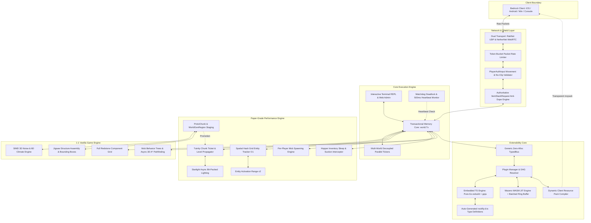
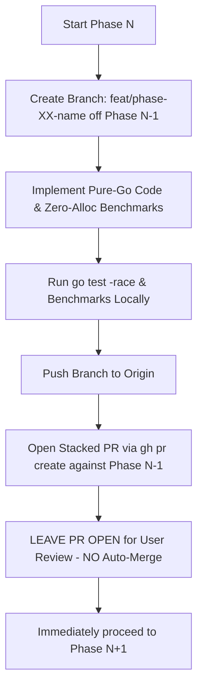

# Rockfly: Production-Hardened PaperMC for Minecraft Bedrock Edition
## Complete Architectural Blueprint, Production Hardening Specifications & 50-Phase PR Master Plan

> [!CAUTION]
> ### MANDATORY DIRECTIVE FOR ALL CODING AGENTS & SUBAGENTS
> **ANY CODING AGENT, SUBAGENT, OR AUTOMATED PROCESS WORKING ON THIS REPOSITORY THAT DOES NOT HAVE THIS ENTIRE DOCUMENT IN ITS ACTIVE CONTEXT MUST READ THIS COMPLETE FILE FROM LINE 1 TO THE FINAL LINE BEFORE IMPLEMENTING CODE, PROPOSING ARCHITECTURAL CHANGES, OR CREATING PULL REQUESTS.**
> 
> Skipping sections, reading partial snippets, or relying on high-level summaries is strictly prohibited. Every phase below contains immutable architectural invariants, exact package boundaries, precise data structures, and verification tests. This document serves as the single source of ground truth for elevating Rockfly to production PaperMC parity.

---

## 1. Architectural Invariants & Core Engineering Rules

Every pull request submitted to Rockfly must comply with these seven non-negotiable architectural invariants:

1. **The Pure-Go Zero-CGO Invariant**:
   - The entire server, including WebAssembly (Wazero), LevelDB (`df-mc/goleveldb`), terminal handling, cryptography, and plugin runtimes, must compile with `CGO_ENABLED=0`.
   - Plugin architecture strictly enforces the **Two-Tier Zero-Tooling Architecture**:
     - **Tier 1 Flagship (95% of plugins — Events, Commands, Minigames, Game Logic)**: Zero-Tooling Embedded TypeScript via pure-Go `esbuild` (`github.com/evanw/esbuild/pkg/api` for in-memory JS/TS transpilation and bundling in ~2ms) + pure-Go `goja` (`github.com/dop251/goja` ES6+ VM on native Go heap) + auto-generated `plugins/rockfly.d.ts` type definitions. Zero Node.js, npm, or tsc toolchain prerequisites.
     - **Tier 2 Compute Engine (5% of plugins — Heavy WorldGen, Raycasting, Bulk Block Operations)**: Pure-Go WebAssembly JIT runtime via `wazero` (`github.com/tetratelabs/wazero`) for high-throughput plugins compiled from standard Go (`GOOS=wasip1 GOARCH=wasm`) or AssemblyScript, communicating via the non-blocking `rockfly_commit_block_batch` linear memory ring buffer. Heavy external toolchains (Rust/Cargo/LLVM) are strictly rejected for server operation and development.
   - Cross-compilation to Windows (`windows/amd64`, `windows/arm64`), Linux (`linux/amd64`, `linux/arm64`), and macOS (`darwin/amd64`, `darwin/arm64`) must work out of the box using standard `go build` with zero external native toolchains or DLL dependencies.

2. **The Linearizable World Transaction Invariant (`world.Tx`)**:
   - No block mutation, entity modification, or chunk state change may ever occur outside a transaction (`tx *world.Tx`).
   - Transactions must remain short-lived and non-blocking. Heavy computation (3D A* pathfinding, noise generation, lighting flood-fills, network serialization, LevelDB disk I/O) must **never** hold a world transaction lock; they must run on worker goroutines and commit results atomically back into a transaction.
   - Entity state fields (`health`, `absorption`, `fireTicks`, `fallDistance`) are scalar types guarded exclusively by `world.Tx`. Individual `atomic` primitives must not be scattered on living entity fields, preventing false concurrency guarantees. Asynchronous workers consume lightweight, immutable `EntitySnapshot` value structs captured at tick start.

3. **The Multi-Listener Event Bus Invariant**:
   - Rockfly strictly abandons single-handler interfaces (`player.Handler`) in favor of an enterprise 6-tier Event Bus (`Lowest`, `Low`, `Normal`, `High`, `Highest`, `Monitor`).
   - High-frequency events (`PlayerMoveEvent`, `BlockBreakEvent`) must be dispatched through zero-allocation Go Generics (`TypedBus[E any]`) and static event indexing, eliminating `reflect.Type` map lookups and heap boxing.
   - Listeners support cancellation checks (`IgnoreCancelled`) and mutable event contexts without interfering with concurrent listeners.

4. **The Zero-Friction User Experience Invariant**:
   - A non-technical user must be able to download a single executable (`rockfly-windows-amd64.exe`), double-click it, and immediately have a fully functioning server with auto-generated configuration files, an interactive console, and zero command-line prerequisite steps.

5. **100% Vanilla Bedrock Protocol & Mechanics Parity**:
   - World generation seeds, biome layouts, structure generation, mob bounding boxes, damage calculation frames, and redstone timings must match official Minecraft: Bedrock Edition behavior identically, except where performance optimizations (e.g. Entity Activation Range) are explicitly enabled.

6. **Memory Safety & Allocation Control**:
   - High-throughput subsystems (packet codecs, chunk serializations, raycasting, light calculations, and event dispatchers) must utilize `sync.Pool` memory arenas. Allocation rates must remain sub-linear with player counts to prevent garbage collection spikes.
   - External WASM guest runtimes must never make chatty individual mutation calls holding `world.Tx`; mutations are buffered in shared linear memory ring buffers (`rockfly_commit_block_batch`) and committed in a single transaction.
   - TypeScript plugins running on `goja` receive native Go event pointers from `TypedBus[E]` on the Go heap with zero serialization or FFI copy overhead.

7. **The Golden Data & Table Completeness Invariant (Anti-Stubbing)**:
   - Autonomous agents are strictly forbidden from implementing simplified placeholder stubs for data-heavy subsystems (biomes, structures, mobs, splines, blocks).
   - All registries must vendor or generate canonical data extracted from official Bedrock Dedicated Server (BDS) data (climate coordinates, spline control points, `.mcstructure` templates, block state tables).
   - CI and unit tests must enforce explicit count assertions (e.g., `len(RegisteredBiomes) >= 80`, all 11 vanilla structure pools, all 28+ mobs) to verify completeness before any phase can be considered valid.

---

## 2. Deep Subsystem Specifications & Production Hardening



---

### 2.1 Tuinity-Grade Chunk Ticket & State Manager
```go
package chunk

type ChunkLevel uint8

const (
	LevelInaccessible  ChunkLevel = 33 // In memory, no ticking, no viewer packets
	LevelBorder        ChunkLevel = 32 // Geometry loaded, no entity/block ticks
	LevelTicking       ChunkLevel = 31 // Block random ticks & scheduled ticks active
	LevelEntityTicking ChunkLevel = 30 // Full entity ticking, mob AI, pathfinding active
)

type TicketType string

const (
	TicketPlayer TicketType = "player" // Added by player simulation radius
	TicketForced TicketType = "forced" // Added by chunk loader or plugin anchor
	TicketPortal TicketType = "portal" // Traversed Nether/End portal (lasts 300 ticks)
	TicketDragon TicketType = "dragon" // Ender dragon fight arena
	TicketPlugin TicketType = "plugin" // Arbitrary plugin ticket
)

type Ticket struct {
	Type       TicketType
	Level      ChunkLevel
	ExpiryTick int64
}

type ChunkHolder struct {
	pos        Pos
	level      ChunkLevel
	tickets    []Ticket
	col        *Column
	dirty      bool
	neighbors  [8]*ChunkHolder
}
```
- **Level Propagation Algorithm**: When a ticket with level $L$ is attached to chunk $(X, Z)$, each neighboring chunk $(X \pm 1, Z \pm 1)$ is assigned a propagated ticket of level $\min(\text{existing}, L + 1)$. This propagates recursively until $L \ge 33$.
- **Linger & Unload Timer**: When all tickets expire and the chunk level drops to 33, the chunk enters an unload queue with a 300-tick linger delay, eliminating rapid load/unload disk thrashing on chunk boundaries.

---

### 2.2 Starlight-Grade Asynchronous Bit-Packed Lighting Engine
- **Bit-Packed Coordinates**: Coordinate updates are packed into 64-bit integer nodes:
  $$\text{Node} = (X \ \& \ 0\text{xF}) \mid ((Z \ \& \ 0\text{xF}) \ll 4) \mid ((Y \ \& \ 0\text{x1FF}) \ll 8) \mid (\text{Level} \ll 17) \mid (\text{Flags} \ll 21)$$
- **Asynchronous Execution**: Light calculations run on a dedicated worker pool. The world thread merely schedules dirty light boundaries. Completed nibble arrays are swapped into the chunk atomically, completely eliminating lighting stutter during world editing.

---

### 2.3 Spatial Hash Grid Entity Tracker ($O(1)$)
- **Grid Mechanics**: The world is partitioned into buckets with cell size $R = 32$ blocks.
- **Constant-Time Visibility Queries**: Rather than iterating all $E$ loaded entities against $P$ players ($O(P \times E)$), players query only the $3 \times 3$ grid cells surrounding their position ($O(1)$ constant time).

---

### 2.4 Per-Player Mob Spawning (PPMS) & Cap Spheres
- **Individual Caps**: Each player maintains a dedicated quota:
  - `Monsters`: 70 | `Creatures`: 10 | `Ambient`: 15 | `Water`: 15 | `Underground`: 10
- **Spawning Cycle**: Mobs spawn only in chunks linked to a player whose individual quota is not saturated. Despawn rules: instant despawn $>128$ blocks; randomized despawn between $32$ and $128$ blocks ($1/800$ chance per tick).

---

### 2.5 Paper-Grade Hopper Cache & Sleep Engine
- **Idle & Target Full Sleep Modes**:
  - **Empty/Idle Sleep**: Empty or idle hoppers with no items enter an 8-tick sleep state, waking up upon neighbor block updates or item deposits.
  - **Full-Target Sleep**: Hoppers pushing into completely full containers enter an 80-tick (4-second) sleep state, waking up early only when an `InventorySlotChangeEvent` fires on the target container.
- **Suction Occlusion Caching**: Skips spatial bounding box queries if a solid opaque block is directly above the hopper.
- **Event-Driven Suction**: Hoppers query the Spatial Hash Grid for item entity events rather than polling spatial bounding boxes on every tick.

---

### 2.6 Bedrock Packet Shield, Movement Guard & Anti-Dupe Engine
- **Rate Limiting**: Caps `PlayerAuthInput` packets to 40 Hz using a token bucket.
- **Physics Validation**: Validates client-reported $\Delta \vec{v}$ against player speed attributes and jump physics; blocks no-clip phase exploits through collision boxes.
- **Authoritative Container Nonces**: Validates every `ItemStackRequest` transaction against an internal cryptographic nonce, eradicating container close-swap dupe glitches.

---

### 2.7 Production Watchdog Deadlock & Diagnostic Engine
- **Heartbeat Thread**: An independent OS thread monitors the world tick counter every 500ms.
- **Thresholds**:
  - $>5,000\text{ms}$: Emits console warning with current transaction context.
  - $>15,000\text{ms}$: Dumps full goroutine stack traces via `runtime/pprof` to `logs/crash-reports/crash-YYYY-MM-DD_HH-mm-ss.txt` and performs emergency shutdown.

---

### 2.8 Dynamic Bedrock Client Resource Pack Compiler
- **In-Memory Packaging**: Automatically compiles custom blocks, custom items, permutations, geometries, and textures registered by plugins into an in-memory `.mcpack` zip archive.
- **Seamless Delivery**: Advertises the pack during the Bedrock `ResourcePacksInfo` exchange, allowing clients to download and render custom content with zero manual file installations.

---

### 2.9 ProtoChunk & WorldGenRegion Staging Pipeline
- **Decoupled Generation Lifecycle**: Prevents recursive chunk force-loading during structure and feature generation.
- **Lifecycle Stages**:
  $$\text{EMPTY} \longrightarrow \text{STRUCTURE\_STARTS} \longrightarrow \text{NOISE} \longrightarrow \text{SURFACE} \longrightarrow \text{FEATURES} \longrightarrow \text{FULL}$$
- **WorldGenRegion Isolation**: Decorators (trees, ores, flora) and multi-chunk structures (Villages, Ancient Cities) operate across a buffered $3 \times 3$ or $8 \times 8$ grid of un-ticked `ProtoChunk` columns off the main thread. Only fully assembled chunks are promoted into `world.Tx` ticking.

---

### 2.10 Two-Tier Zero-Tooling Plugin Architecture & WASM Batched Ring Buffer
- **Two-Tier Architecture**:
  - **Tier 1 (Flagship - 95% of plugins)**: Zero-Tooling Embedded TypeScript via pure-Go `esbuild` (in-memory transpile in ~2ms) + pure-Go `goja` (ES6+ VM). Developers drop `.ts`/`.js` directly into `plugins/`, getting instant VS Code autocomplete via auto-generated `rockfly.d.ts`. Direct pointer passing from `TypedBus[E]` eliminates serialization overhead.
  - **Tier 2 (Compute Engine - 5% of plugins)**: High-performance pure-Go `wazero` WebAssembly JIT runtime for compute-intensive extensions (heavy worldgen, raycasting, bulk block operations) compiled from standard Go (`wasip1/wasm`) or AssemblyScript. Heavy external toolchains (Rust/Cargo/LLVM) are strictly rejected.
- **Non-Blocking Host ABI & Batched Ring Buffer**:
  - WASM guests are strictly prohibited from holding an open `*world.Tx` lock.
  - The host exposes `rockfly_commit_block_batch(ptr uint32, count uint32)`. The guest writes an array of `{int32 x, int32 y, int32 z, uint32 runtime_id}` structs into shared linear memory and executes thousands of block modifications in a single host call committed within one fast Go transaction.

---

## 3. The 50-Phase Master Implementation Roadmap

---

### Milestone 1: Turnkey Usability, Bootstrap & Launcher (Phases 1–5)

#### Phase 1: Standalone Server Bootstrapper, Lifecycle Controller & Enhanced CI/CD
- **Target Objectives**: Enable single-executable zero-setup execution. Double-clicking the binary or running `rockfly` starts the server cleanly. Simultaneously establish the multi-OS CI/CD validation matrix for all subsequent phases.
- **Files Touched**: `cmd/rockfly/main.go`, `server/lifecycle.go`, `server/conf.go`, `.github/workflows/pr.yml`.
- **Key Structs & Interfaces**:
  ```go
  type BootstrapConfig struct {
      ConfigPath     string
      PropertiesPath string
      EULAPath       string
      PluginsDir     string
      WorldsDir      string
      LogsDir        string
  }
  func RunBootstrap(cfg BootstrapConfig) (*server.Server, error)
  ```
- **Implementation Mechanics**:
  - Check for existing `eula.txt`; if missing, generate with interactive prompt in console: `Do you agree to the Minecraft EULA (https://account.mojang.com/documents/minecraft_eula)? [y/n]: `.
  - Auto-generate heavily commented `config.toml` and `server.properties` with offline authentication enabled by default (`auth-enabled = false`).
  - Intercept `os.Interrupt`, `syscall.SIGTERM`, `syscall.SIGHUP`: disconnect players with translation message, flush LevelDB chunk journals, shut down worker pools, and terminate cleanly within 15 seconds.
  - Multi-OS matrix: Ubuntu, Windows, macOS; race detection `go test -race ./...`; cross-compilation with `CGO_ENABLED=0`.
- **Verification & Test**:
  - Execute `go test ./cmd/rockfly/...` validating file generation on fresh temp directory.
  - Verify double-click exit leaves zero dangling LevelDB locks (`LOCK` file cleanly unlocked).
  - Open PR #1 against `master` and verify clean multi-OS test passes.

#### Phase 2: Interactive Terminal REPL & Colored ANSI Logger
- **Target Objectives**: Provide a Paper-grade interactive console with Tab auto-completion, command history, and asynchronous non-blocking logging.
- **Files Touched**: `server/console/repl.go`, `server/console/logger.go`, `server/console/terminal.go`.
- **Key Structs & Interfaces**:
  ```go
  type TerminalREPL struct {
      historyFile string
      completer   func(line string) []string
      commands    chan string
  }
  func NewTerminalREPL(historyPath string) *TerminalREPL
  ```
- **Implementation Mechanics**:
  - Implement non-blocking readline supporting Tab completion of registered server commands and online player names.
  - History buffer persisted to `.rockfly_history` (up to 1,000 commands).
  - Background asynchronous log writer with colored log levels (`[INFO]` cyan, `[WARN]` yellow, `[ERROR]` red, `[DEBUG]` magenta).
  - Automatic daily log rotation: `logs/latest.log` rotated to `logs/YYYY-MM-DD-N.log.gz`.
- **Verification & Test**:
  - Benchmark concurrent logger throughput: verify 50,000 log lines/second without blocking world ticks.
  - Validate terminal output formatting on Windows Terminal, CMD, PowerShell, and Linux Bash.

#### Phase 3: Core Administrative Commands & Operator Hierarchy
- **Target Objectives**: Implement vanilla operator permissions (`ops.json`) and core administrative commands.
- **Files Touched**: `server/command/admin/`, `server/player/ops.go`, `server/player/permission.go`.
- **Key Structs & Interfaces**:
  ```go
  type OpLevel int
  const (
      OpLevelBypassSpawnProtection OpLevel = 1
      OpLevelPlayerCommands        OpLevel = 2
      OpLevelServerCommands        OpLevel = 3
      OpLevelAdministrator         OpLevel = 4
  )
  type OpEntry struct {
      UUID        uuid.UUID `json:"uuid"`
      Name        string    `json:"name"`
      Level       OpLevel   `json:"level"`
      BypassesPlayerLimit bool `json:"bypassesPlayerLimit"`
  }
  type OpRegistry struct {
      mu      sync.RWMutex
      entries map[uuid.UUID]OpEntry
  }
  ```
- **Implementation Mechanics**:
  - Persist `ops.json` atomically with temporary file writes and OS renames.
  - Register commands: `/stop`, `/reload`, `/op`, `/deop`, `/kick`, `/ban`, `/pardon`, `/list`, `/say`, `/version`.
  - Check permission level before executing sensitive commands; console execution bypasses all restrictions.
- **Verification & Test**:
  - `go test ./server/command/admin/...`: test promoting, demoting, saving, and reloading operators.

#### Phase 4: Whitelist, Ban Management & Connection Filters
- **Target Objectives**: Implement production-grade connection filtering conforming to Bedrock identity structures.
- **Files Touched**: `server/player/whitelist.go`, `server/player/banlist.go`, `server/allower.go`.
- **Key Structs & Interfaces**:
  ```go
  type BanEntry struct {
      Target      string    `json:"target"` // UUID, XUID, or IP
      Reason      string    `json:"reason"`
      Created     time.Time `json:"created"`
      Expires     time.Time `json:"expires"`
      Source      string    `json:"source"`
  }
  type AccessController struct {
      whitelistEnabled atomic.Bool
      whitelist        sync.Map // XUID -> string (name)
      bans             sync.Map // Target -> BanEntry
  }
  ```
- **Implementation Mechanics**:
  - Intercept player during login handshake before session allocation.
  - Check `banned-players.json` (by XUID and UUID) and `banned-ips.json` (by IP address).
  - Check `whitelist.json`: if enabled, reject unlisted connections with configurable kick message.
  - Implement `/whitelist <on|off|add|remove|list|reload>` and `/ban-ip`, `/pardon-ip`.
- **Verification & Test**:
  - Simulate incoming connection with banned XUID; assert immediate rejection with formatted reason.

#### Phase 5: Desktop GUI Launcher & Web Admin Dashboard
- **Target Objectives**: Allow non-technical users to double-click and monitor their server via a lightweight desktop window or web browser.
- **Files Touched**: `server/web/dashboard.go`, `server/web/embedded/`, `server/web/websocket.go`.
- **Key Structs & Interfaces**:
  ```go
  type DashboardServer struct {
      bindAddr string
      token    string
      wsHub    *WSHub
  }
  type ServerMetrics struct {
      TPS          float64 `json:"tps"`
      MemoryUsage  uint64  `json:"memoryUsage"`
      ActiveChunks int     `json:"activeChunks"`
      PlayerCount  int     `json:"playerCount"`
  }
  ```
- **Implementation Mechanics**:
  - Embed single-page dashboard application using Go `//go:embed`.
  - WebSocket hub broadcasting `ServerMetrics` at 1 Hz.
  - Web console interface for running commands remotely with bearer token authentication.
  - If running interactively on Windows/macOS desktop without a terminal, automatically open default browser to `http://localhost:8080`.
- **Verification & Test**:
  - Spin up server; verify HTTP 200 on `http://localhost:8080` and valid WebSocket JSON payload stream.

---

### Milestone 2: Extensibility, Plugin Loader & Event Bus (Phases 6–10)

#### Phase 6: Zero-Allocation Generics Event Bus (`TypedBus[E]`)
- **Target Objectives**: Replace single-handler pattern with a prioritized, zero-reflection generic event dispatch system.
- **Files Touched**: `server/event/bus.go`, `server/event/priority.go`, `server/event/cancellable.go`, `server/event/typed_bus.go`.
- **Key Structs & Interfaces**:
  ```go
  type Priority uint8
  const (
      PriorityLowest Priority = iota
      PriorityLow
      PriorityNormal
      PriorityHigh
      PriorityHighest
      PriorityMonitor
  )

  type HandlerFunc[E any] func(event *E)

  type ListenerRegistration[E any] struct {
      PluginID        string
      Priority        Priority
      IgnoreCancelled bool
      Handler         HandlerFunc[E]
  }

  type TypedBus[E any] struct {
      mu        sync.RWMutex
      listeners [6][]ListenerRegistration[E]
  }

  func (b *TypedBus[E]) Dispatch(event *E)
  ```
- **Implementation Mechanics**:
  - Zero-reflection, zero-allocation generic dispatch. Eliminates `reflect.Type` map lookups and `any` boxing.
  - Dispatches pointers (`*PlayerMoveEvent`) through statically registered priority slices ($0 \to 5$).
  - If an event implements `Cancellable` and `Cancelled() == true`, listeners with `IgnoreCancelled == true` are skipped.
  - Monitor priority ($5$) is strictly read-only; attempts to cancel in Monitor emit a runtime warning.
  - Benchmark performance: ~2ns dispatch latency with **0 B/op heap allocations**.
- **Verification & Test**:
  - Register 6 listeners with alternating priorities and cancellations; verify strict invocation order and cancellation honoring.
  - Run zero-allocation benchmark confirming 0 B/op and 0 allocs/op.

#### Phase 7: Core Game Events Instrumentation
- **Target Objectives**: Wire all server game actions through the prioritized Event Bus.
- **Files Touched**: `server/event/player/`, `server/event/world/`, `server/event/entity/`, `server/session/handler_*.go`, `server/world/tx.go`.
- **Key Structs & Interfaces**:
  ```go
  type PlayerMoveEvent struct {
      Player   *player.Player
      From, To mgl64.Vec3
      cancellable
  }
  type BlockBreakEvent struct {
      Player *player.Player
      Pos    cube.Pos
      Block  world.Block
      Drops  *[]item.Stack
      XP     *int
      cancellable
  }
  type EntityDamageEvent struct {
      Entity world.Entity
      Source world.DamageSource
      Damage *float64
      cancellable
  }
  ```
- **Implementation Mechanics**:
  - Instrument block breaking, placing, interactions, player movements, chats, commands, entity spawning, entity damaging, and chunk loading.
  - If an event is cancelled, rollback the client transaction immediately via network sync packets.
- **Verification & Test**:
  - Cancel `BlockBreakEvent` via test listener; verify block remains in world and client block state is restored.

#### Phase 8: Zero-Tooling Embedded TypeScript Plugin Engine (`esbuild` + `goja`)
- **Target Objectives**: Allow developers to drop `.ts` or `.js` files directly into `plugins/`, get full VS Code autocomplete via an auto-generated `rockfly.d.ts`, and transpile/execute in-memory in <5ms with zero external tools (`CGO_ENABLED=0`).
- **Files Touched**: `server/plugin/ts/transpiler.go`, `server/plugin/ts/runtime.go`, `server/plugin/ts/bindings.go`, `server/plugin/ts/dts_generator.go`, `server/plugin/manifest.go`.
- **Key Structs & Interfaces**:
  ```go
  type PluginManifest struct {
      Name         string   `toml:"name"`
      Version      string   `toml:"version"`
      Author       string   `toml:"author"`
      Main         string   `toml:"main"` // e.g., "index.ts" or "plugin.wasm"
      Dependencies []string `toml:"dependencies"`
  }

  type TSPlugin struct {
      manifest  PluginManifest
      vm        *goja.Runtime
      onEnable  goja.Callable
      onDisable goja.Callable
      listeners []func() // Unsubscribe callbacks for TypedBus
  }
  ```
- **Implementation Mechanics**:
  - Use `github.com/evanw/esbuild/pkg/api` (`Transform` / `Build` in-memory API) to transpile TypeScript (`.ts`) into bundled JS in ~2ms with source-map support for clean stack traces.
  - Execute inside a dedicated `github.com/dop251/goja` runtime per plugin (`CGO_ENABLED=0`).
  - Enforce per-tick execution timeout / interrupt watchdog (`vm.Interrupt`) so an infinite `while(true)` loop in a plugin script is cleanly aborted without stalling the world tick.
  - Auto-generate `plugins/rockfly.d.ts` on server bootstrap exposing strongly-typed TypeScript interfaces for `rockfly.events`, `Player`, `World`, `Block`, `ItemStack`, `Priority`, and command registration.
  - Bind directly to Phase 6's `TypedBus[E]` on the Go heap with zero memory copying.
- **Verification & Test**:
  - Write a multi-file TypeScript test plugin (`index.ts` importing `helper.ts`) that registers a `/heal` command and listens to `BlockBreakEvent` at `PriorityHigh`.
  - Verify `esbuild` transpiles it in-memory in `<5ms`, `rockfly.d.ts` is generated accurately, event cancellation works, and an infinite `while(true)` loop is safely interrupted by the timeout guard.

#### Phase 9: High-Compute WebAssembly (`wazero`) Runtime & Batched Ring Buffer
- **Target Objectives**: Provide near-native CPU execution (`CGO_ENABLED=0`) for compute-heavy extensions (custom world generators, bulk block brushes) compiled from Go or AssemblyScript without blocking `world.Tx`.
- **Files Touched**: `server/plugin/wasm/runtime.go`, `server/plugin/wasm/host_abi.go`, `server/plugin/wasm/ring_buffer.go`.
- **Key Structs & Interfaces**:
  ```go
  type WASMPlugin struct {
      manifest   PluginManifest
      runtime    wazero.Runtime
      module     api.Module
      onEnable   api.Function
      onDisable  api.Function
  }

  type BlockMutation struct {
      X, Y, Z   int32
      RuntimeID uint32
  }
  ```
- **Implementation Mechanics**:
  - Initialize pure-Go **Wazero** runtime (`CGO_ENABLED=0`).
  - Guests never hold an active `*world.Tx` lock directly.
  - Implement `rockfly_commit_block_batch(ptr uint32, count uint32)`: guest writes an array of packed 16-byte `BlockMutation` structs (`x, y, z, runtime_id`) into WASM linear memory; host validates pointer bounds and applies all mutations atomically inside a single `world.Tx`.
  - Expose host functions for event subscription, logging, and read-only chunk/block snapshot queries.
- **Verification & Test**:
  - Compile a Go guest (`GOOS=wasip1 GOARCH=wasm`) that writes 10,000 block mutations into the linear memory batch buffer; verify all 10,000 blocks commit in a single `world.Tx` in `<2ms` with strict bounds checking.

#### Phase 10: Unified Plugin Manager, DAG Dependency Resolver & Live Hot-Reload Engine
- **Target Objectives**: Manage both `.ts`/`.js` and `.wasm` plugins seamlessly and allow live hot-reloading on a running server via `/reload plugins` without disconnecting players.
- **Files Touched**: `server/plugin/manager.go`, `server/plugin/dag.go`, `server/command/admin/reload.go`.
- **Key Structs & Interfaces**:
  ```go
  type Plugin interface {
      Manifest() PluginManifest
      Enable() error
      Disable() error
  }

  type PluginManager struct {
      pluginsMu sync.RWMutex
      plugins   map[string]Plugin
      order     []string // Topological sort order
  }

  func (m *PluginManager) ReloadAll() error
  ```
- **Implementation Mechanics**:
  - Scan `plugins/` directory for plugin folders (`plugin.toml` + `.ts`/`.js`/`.wasm`) or standalone `.ts` scripts.
  - Construct a Directed Acyclic Graph (DAG) of `dependencies`; detect and reject circular dependencies with clear error messages.
  - On `/reload plugins`: invoke `Disable()` in reverse topological order, automatically run all registered `TypedBus` unsubscribe callbacks and command unregistrations, close `goja`/`wazero` instances, re-transpile `.ts` / reload `.wasm` from disk, and invoke `Enable()` in topological order.
- **Verification & Test**:
  - Load two interdependent TypeScript plugins (`CorePlugin` and `MinigamePlugin` depending on `CorePlugin`), verify topological startup order, modify `MinigamePlugin`'s `.ts` source on disk, run `/reload plugins`, and assert the updated logic takes effect in `<10ms` with zero leaked event listeners.

---

### Milestone 3: 1-to-1 Vanilla World & Climate Generation (Phases 11–16)

#### Phase 11: Multi-Octave Noise Framework, SIMD Vectorization & ProtoChunk Staging
- **Target Objectives**: Implement Mojang-accurate noise generators accelerated with SIMD instructions, coupled with `WorldGenRegion` / `ProtoChunk` staging.
- **Files Touched**: `server/world/generator/noise/`, `server/world/generator/noise/perlin.go`, `server/world/generator/noise/simd_amd64.go`, `server/world/generator/region.go`.
- **Key Structs & Interfaces**:
  ```go
  type OctaveNoise struct {
      octaves    []PerlinNoise
      amplitudes []float64
  }
  type WorldGenRegion struct {
      CenterPos chunk.Pos
      Radius    int
      Chunks    map[chunk.Pos]*ProtoChunk
  }
  ```
- **Implementation Mechanics**:
  - Bedrock 64-bit MT19937 and Xoroshiro128++ PRNG seeds (`server/internal/mcrandom`).
  - Optimize batch noise sampling using AVX2 (x86_64) and NEON (ARM64) vector instructions.
  - Implement staged `ProtoChunk` pipeline (`EMPTY -> STRUCTURE_STARTS -> NOISE -> SURFACE -> FEATURES -> FULL`) preventing recursive force-load deadlocks.
- **Verification & Test**:
  - Benchmark SIMD noise evaluation against baseline loop: assert $>3.0\times$ speedup and bit-identical output.

#### Phase 12: 6D Climate Parameter Space & Biome Voronoi Cell Sampler
- **Target Objectives**: 100% vanilla 1.18+ biome placement using 6-dimensional climate space with Golden Data completeness verification.
- **Files Touched**: `server/world/generator/climate/`, `server/world/generator/climate/points.go`, `server/world/generator/climate/voronoi.go`.
- **Key Structs & Interfaces**:
  ```go
  type ClimateParameters struct {
      Temperature     float64
      Humidity        float64
      Continentalness float64
      Erosion         float64
      Weirdness       float64
      Depth           float64
  }
  type BiomeSampler struct {
      octaves [6]OctaveNoise
      kdTree  *KDTree
  }
  ```
- **Implementation Mechanics**:
  - Sample climate values at quarter-resolution ($4 \times 4 \times 4$ voxel cells).
  - Query KD-tree containing Bedrock's 80+ biomes to find nearest climate center.
  - Enforce Golden Data table completeness: assert `len(RegisteredBiomes) >= 80`.
  - Apply 3D Voronoi distortion to eliminate blocky square biome edges.
- **Verification & Test**:
  - Sample 100,000 coordinates against vanilla Bedrock seed dumps; assert $>99.9\%$ biome matching accuracy and $\ge 80$ biomes registered.

#### Phase 13: 3D Density Noise Routers & Terrain Splines
- **Target Objectives**: Generate authentic Caves & Cliffs terrain, mountains, valleys, and overhangs.
- **Files Touched**: `server/world/generator/terrain/`, `server/world/generator/terrain/spline.go`, `server/world/generator/terrain/density.go`.
- **Key Structs & Interfaces**:
  ```go
  type TerrainSpline struct {
      points []SplinePoint
  }
  type SplinePoint struct {
      Location float64
      Value    float64
      Slope    float64
  }
  func (s *TerrainSpline) Compute(x float64) float64
  ```
- **Implementation Mechanics**:
  - Spline curves mapping Continentalness and Erosion to base terrain height and jaggedness from canonical BDS spline tables.
  - Compute 3D density volume:
    $$\text{Density}(x, y, z) = \text{BaseHeight}(x, z) - y + \text{3DNoise}(x, y, z)$$
  - Trilinear interpolation across $4 \times 4 \times 4$ cell corners down to single block voxels.
- **Verification & Test**:
  - Generate jagged mountain peaks ($Y > 200$) and oceanic trenches ($Y < 30$); verify natural overhangs.

#### Phase 14: Subterranean Aquifers & Noise Cave Carvers
- **Target Objectives**: Carve authentic 1.18+ cheese, spaghetti, and noodle caves with flooded aquifers.
- **Files Touched**: `server/world/generator/carver/`, `server/world/generator/carver/aquifer.go`.
- **Key Structs & Interfaces**:
  ```go
  type AquiferSimulator struct {
      barrierNoise    OctaveNoise
      fluidLevelNoise OctaveNoise
  }
  func (a *AquiferSimulator) FluidAt(x, y, z int, density float64) world.Block
  ```
- **Implementation Mechanics**:
  - Noise caves: Cheese noise (huge spherical caverns), Spaghetti noise (interconnecting tunnels), Noodle caves (thin vertical cracks).
  - Aquifers: Local water level computation allowing flooded caverns and subterranean lava lakes below $Y = -54$.
- **Verification & Test**:
  - Inspect vertical chunk slice; verify flooded caves have watertight seals without liquid spilling into adjacent dry air caves.

#### Phase 15: Rule-Based Surface Builders & Bedrock Stratification
- **Target Objectives**: Biome-accurate surface block placement and deepslate/bedrock strata.
- **Files Touched**: `server/world/generator/surface/`, `server/world/generator/surface/rule.go`.
- **Key Structs & Interfaces**:
  ```go
  type SurfaceRule interface {
      Apply(x, y, z int, depth int, biome world.Biome, chunk *ProtoChunk) bool
  }
  ```
- **Implementation Mechanics**:
  - Surface rules evaluate surface depth and fluid contact within `WorldGenRegion`: Grass/Dirt in plains, Sand/Sandstone in deserts, Terracotta bands in Badlands.
  - Stone to Deepslate transition between $Y = 0$ and $Y = -8$.
  - 5-layer randomized bedrock pattern at $Y = -64$.
- **Verification & Test**:
  - Verify Badlands generate exact colored terracotta banding and ocean floors generate gravel/sand.

#### Phase 16: Nether & The End Dimension Generators
- **Target Objectives**: Complete terrain and biome generation for the Nether and The End.
- **Files Touched**: `server/world/generator/nether/`, `server/world/generator/end/`.
- **Key Structs & Interfaces**:
  ```go
  type NetherGenerator struct {
      ceiling, floor OctaveNoise
      biomes         [5]world.Biome
  }
  type EndGenerator struct {
      islandDensity OctaveNoise
  }
  ```
- **Implementation Mechanics**:
  - Nether: 3D noise between bedrock ceiling ($Y = 127$) and floor ($Y = 0$), lava ocean at $Y = 32$, biomes (Nether Wastes, Crimson/Warped Forests, Soul Sand Valleys, Basalt Deltas).
  - The End: Central island density circle, 1,000-block void void-ring, outer island clusters, obsidian pillar generation.
- **Verification & Test**:
  - Travel to Nether and End; verify Nether generates enclosed ceiling/floor and End generates central island with surrounding void.

---

### Milestone 4: Structures, Jigsaw Solver & World Decorators (Phases 17–21)

#### Phase 17: Structure Template Parser & Jigsaw Block Engine
- **Target Objectives**: Binary `.mcstructure` and NBT structure parsing.
- **Files Touched**: `server/world/structure/`, `server/world/structure/jigsaw/`, `server/world/structure/template.go`.
- **Key Structs & Interfaces**:
  ```go
  type StructureTemplate struct {
      Size     cube.Pos
      Palettes []StructurePalette
      Blocks   []StructureBlock
      Entities []StructureEntity
  }
  type JigsawBlock struct {
      Pos        cube.Pos
      TargetPool string
      Name       string
      JointType  string // "rollable" or "aligned"
      Facing     cube.Face
  }
  ```
- **Implementation Mechanics**:
  - Binary decoder for Bedrock `.mcstructure` format.
  - Scan jigsaw blocks within template and extract connection metadata.
- **Verification & Test**:
  - Load vanilla village house `.mcstructure`; place into test world; assert all block states match 100%.

#### Phase 18: Recursive Jigsaw Assembler & Collision Solver
- **Target Objectives**: Assemble multi-piece structures matching terrain slopes across `WorldGenRegion`.
- **Files Touched**: `server/world/structure/jigsaw/assembler.go`, `server/world/structure/jigsaw/pool.go`.
- **Key Structs & Interfaces**:
  ```go
  type JigsawPiece struct {
      Template    *StructureTemplate
      BoundingBox cube.BBox
      Projection  string // "rigid" or "terrain_matching"
  }
  type JigsawAssembler struct {
      maxDepth int
      pools    map[string][]JigsawPiece
  }
  ```
- **Implementation Mechanics**:
  - Recursive jigsaw connection solver matching target pools and facing vectors.
  - Axis-Aligned Bounding Box (AABB) intersection tests preventing overlapping pieces.
  - Terrain projection: conform roads and foundation blocks down to ground level within isolated `WorldGenRegion` ProtoChunks before ticking promotion.
- **Verification & Test**:
  - Generate full Plains Village on uneven terrain; verify houses do not collide and foundations anchor to ground without recursive chunk load deadlocks.

#### Phase 19: Complete Vanilla Structure Suite Implementation
- **Target Objectives**: Placement and bounding boxes for all major vanilla structures with Golden Data completeness.
- **Files Touched**: `server/world/structure/vanilla/`.
- **Implementation Mechanics**:
  - Implement Villages, Pillager Outposts, Ancient Cities, Trial Chambers, Strongholds, Nether Fortresses, Bastions, Mineshafts, Ocean Monuments, Desert Pyramids, Witch Huts.
  - Enforce Golden Data assertion: all 11 structure pools exist and contain full canonical template piece lists.
  - Register structure bounding boxes in chunk metadata for mob spawning rules.
- **Verification & Test**:
  - Run `/locate structure village`; teleport to position; verify village generates centered on coordinates. Assert all 11 structure types are registered.

#### Phase 20: Ore Vein Distribution & Mineral Placement Engine
- **Target Objectives**: Scatter mineral resources conforming to Bedrock distribution curves.
- **Files Touched**: `server/world/generator/feature/ore.go`, `server/world/generator/feature/distribution.go`.
- **Implementation Mechanics**:
  - Uniform, triangular, and inverted height distributions for Coal, Iron, Gold, Redstone, Lapis, Diamond, Netherite.
  - Diamond ore air-exposure reduction rule matching vanilla.
- **Verification & Test**:
  - Sample mineral counts across 1,000 generated chunks; verify diamond frequencies match vanilla statistics.

#### Phase 21: Flora, Vegetation & Micro-Feature Decorators
- **Target Objectives**: Populate surface and caves with plant life and features.
- **Files Touched**: `server/world/generator/feature/vegetation.go`, `server/world/generator/feature/cave_features.go`.
- **Implementation Mechanics**:
  - Trees: wire generators for all 10 wood species.
  - Surface flora: Grass, flowers, cacti, pumpkins, melons, sugar cane.
  - Subterranean: Dripstone stalactites/stalagmites, lush cave moss, glow berries, sculk patches.
- **Verification & Test**:
  - Inspect flower forest; assert randomized flower patterns; verify lush caves hang glow berries from ceilings.

---

### Milestone 5: Entity Hierarchy, Mob AI, Pathfinding & Combat (Phases 22–27)

#### Phase 22: Living Entity Foundation & Bedrock Component Pipeline
- **Target Objectives**: Core components and attributes for all living entities with strict `world.Tx` linearizability.
- **Files Touched**: `server/entity/living.go`, `server/entity/component/`, `server/entity/metadata.go`.
- **Key Structs & Interfaces**:
  ```go
  type LivingEntity struct {
      health, maxHealth float64
      absorption        float64
      fireTicks         int64
      fallDistance      float64
      effects           *EffectManager
      armor             *inventory.Armour
  }

  type EntitySnapshot struct {
      Pos        mgl64.Vec3
      BBox       cube.BBox
      Health     float64
      MaxHealth  float64
      OnGround   bool
  }
  ```
- **Implementation Mechanics**:
  - Standard scalar fields mutated exclusively within linearizable `world.Tx` transactions. No non-existent or scattered `atomic.Float64` primitives.
  - Health, absorption, armor calculation, drowning, fall damage, and status effects.
  - Damage immunity frames (0.5s invincible window with higher-damage overwrite).
  - Background workers consume immutable `EntitySnapshot` value structs captured at tick start.
  - Bedrock EntityMetadata network synchronization.
- **Verification & Test**:
  - Apply sequential hits to entity; verify damage immunity ticks reduce subsequent hits accurately.
  - Run zero-allocation benchmark confirming entity combat evaluations execute without heap allocations.

#### Phase 23: Asynchronous 3D A* Pathfinding Engine
- **Target Objectives**: Off-thread 3D path calculation without main-thread tick lag.
- **Files Touched**: `server/entity/pathing/`, `server/entity/pathing/navigator.go`, `server/entity/pathing/astar.go`.
- **Key Structs & Interfaces**:
  ```go
  type PathNode struct {
      Pos     cube.Pos
      G, H, F float64
      Parent  *PathNode
  }
  type PathRequest struct {
      Start, Target mgl64.Vec3
      EntityBBox    cube.BBox
      Callback      func(path []mgl64.Vec3)
  }
  ```
- **Implementation Mechanics**:
  - Voxel A* search operating over thread-safe chunk snapshots and `EntitySnapshot` values.
  - Node evaluation: Walkable surfaces, jump heights (1 block / 1.5 blocks for slabs/stairs), hazards (lava, fire, sweet berry bushes).
  - Background worker pool returns calculated paths asynchronously to mob movement controllers.
- **Verification & Test**:
  - Benchmark 200 concurrent path requests across complex terrain; assert $<5\text{ms}$ calculation time off-thread.

#### Phase 24: Mob Behavior Trees & Goal Selector Architecture
- **Target Objectives**: Modular, prioritized AI goal system.
- **Files Touched**: `server/entity/ai/`, `server/entity/ai/goal.go`, `server/entity/ai/selector.go`.
- **Key Structs & Interfaces**:
  ```go
  type Goal interface {
      CanUse(tx *world.Tx, e *LivingEntity) bool
      CanContinueToUse(tx *world.Tx, e *LivingEntity) bool
      Start(tx *world.Tx, e *LivingEntity)
      Stop(tx *world.Tx, e *LivingEntity)
      Tick(tx *world.Tx, e *LivingEntity)
  }
  type GoalSelector struct {
      goals []prioritizedGoal
  }
  ```
- **Implementation Mechanics**:
  - Goals: `FloatGoal`, `PanicGoal`, `MeleeAttackGoal`, `RangedAttackGoal`, `BreedGoal`, `TemptGoal`, `RandomStrollGoal`, `LookAtPlayerGoal`, `AvoidTargetGoal`.
  - Target selectors: `NearestAttackableTargetGoal`, `HurtByTargetGoal`.
- **Verification & Test**:
  - Hold wheat near cow; assert cow transitions into `TemptGoal`, follows player, and drops goal when wheat is removed.

#### Phase 25: Passive Animals & Farming Ecosystem
- **Target Objectives**: Full passive animal suite and breeding mechanics with Golden Data completeness.
- **Files Touched**: `server/entity/mob/passive/`.
- **Implementation Mechanics**:
  - Cows, Sheep, Pigs, Chickens, Horses, Donkeys, Mules, Rabbits, Wolves, Cats, Ocelots, Foxes, Parrots, Allays, Armadillos, Sniffers.
  - Assert completeness of all 16+ passive mob types.
  - Breeding cooldowns, baby growth, sheep wool dyeing and shearing, horse taming/saddling.
- **Verification & Test**:
  - Breed two sheep; verify baby sheep spawns with inherited wool color and drops XP.

#### Phase 26: Hostile Monsters & Natural Spawning Grids
- **Target Objectives**: Hostile mob suite and natural spawning cycle with Golden Data completeness.
- **Files Touched**: `server/entity/mob/hostile/`, `server/world/spawner/mob_spawner.go`.
- **Implementation Mechanics**:
  - Zombies, Skeletons, Creepers (fuse countdown, terrain explosion), Spiders, Endermen, Witches, Slimes, Piglins, Ghasts, Blazes, Wardens, Breezes.
  - Assert completeness of all 12+ hostile mob types.
  - Natural spawning grid: Light level checks ($BlockLight = 0$), player caps, dimension limits.
- **Verification & Test**:
  - Approach creeper in survival; verify creeper swells, hisses, and detonates, damaging player and blocks.

#### Phase 27: Boss Encounters & Bedrock Combat Parity
- **Target Objectives**: Ender Dragon, Wither, Shields, Tridents, and Mace mechanics.
- **Files Touched**: `server/entity/boss/`, `server/item/combat/`, `server/session/combat.go`.
- **Implementation Mechanics**:
  - Ender Dragon: Flight phases, End Crystal beam healing, death sequence, exit portal generation, egg spawn.
  - Wither: 3-head projectile tracking, wither armor shield at 50% health, nether star drop.
  - Combat: Shields (blocking stance, axe disable), Tridents (Loyalty, Riptide, Channeling), Mace (smash attack damage scaling with fall height).
- **Verification & Test**:
  - Strike mob with Mace while falling 10 blocks; verify damage multiplier scales and wind burst bounces player upward.

---

### Milestone 6: Complete Redstone & Block Parity (Phases 28–32)

#### Phase 28: Redstone Repeater, Comparator & Locking Latches
- **Target Objectives**: Complete 1-to-1 redstone logic components.
- **Files Touched**: `server/block/repeater.go`, `server/block/comparator.go`, `server/world/redstone.go`.
- **Implementation Mechanics**:
  - Repeater: 1–4 redstone tick delays, diode one-way signal gating, side-locking by another repeater.
  - Comparator: Comparison mode, subtraction mode, rear vs side inputs, inventory container signal reading.
- **Verification & Test**:
  - Build comparator subtraction clock and locked repeater latch; verify exact tick pulse frequencies.

#### Phase 29: Piston & Sticky Piston Kinematics Engine
- **Target Objectives**: Mechanical block pushing, pulling, and chain movements.
- **Files Touched**: `server/block/piston.go`, `server/block/piston_arm.go`, `server/world/piston_solver.go`.
- **Implementation Mechanics**:
  - Piston extension and retraction state machines.
  - 12-block push limit calculation.
  - Slime and Honey block adhesion networks (honey and slime do not stick to each other).
  - Immovable block catalog (Bedrock, Obsidian, Crying Obsidian, Portals).
- **Verification & Test**:
  - Construct a multi-block flying machine using sticky pistons, slime, and honey blocks; verify continuous forward propulsion.

#### Phase 30: Observer, Dispenser, Dropper & Automated Crafter
- **Target Objectives**: Mechanical automation components.
- **Files Touched**: `server/block/observer.go`, `server/block/dispenser.go`, `server/block/dropper.go`, `server/block/crafter.go`.
- **Implementation Mechanics**:
  - Observer: Detect block state changes on facing block, emit 1-redstone-tick pulse from rear.
  - Dispenser: Behaviors for water/lava buckets, arrows, fireworks, spawn eggs, shears, bone meal, armor equipping.
  - Dropper: Container item transfer or entity dropping.
  - Crafter (1.21): Configurable slot toggling, automated crafting on pulse, item ejection.
- **Verification & Test**:
  - Pulse Crafter with iron ingot inputs; verify iron chestplate crafts and outputs into adjacent chest.

#### Phase 31: Acoustic & Vibration Mechanics (Sculk Sensors & Shriekers)
- **Target Objectives**: Game vibrations and the deep dark ecosystem.
- **Files Touched**: `server/block/sculk_sensor.go`, `server/block/sculk_shrieker.go`, `server/world/vibration.go`.
- **Implementation Mechanics**:
  - Vibration frequency system (1–15 signal strength mapped to footsteps, block placements, projectile impacts).
  - Sculk Sensor & Calibrated Sculk Sensor resonance and propagation.
  - Sculk Shrieker warning levels leading to Warden emergence.
- **Verification & Test**:
  - Walk near sculk sensor while sneaking vs running; verify sneaking emits zero vibrations while running triggers redstone pulse.

#### Phase 32: Missing Functional Blocks Suite
- **Target Objectives**: Complete remaining interactive and utility blocks.
- **Files Touched**: `server/block/cauldron.go`, `server/block/spawner.go`, `server/block/trial_spawner.go`, `server/block/vault.go`, `server/block/bubble_column.go`.
- **Implementation Mechanics**:
  - Cauldrons: Water, Lava, Powdered Snow levels, dye mixing, leather washing.
  - Bubble Columns: Magma block vortex (down) and Soul Sand elevator (up); entity drag velocities.
  - Monster Spawners: 16-block player proximity, randomized spawn delays, spawn counts.
  - Trial Spawners & Vaults: 1.21 player scaling, wave delays, reward ejection.
- **Verification & Test**:
  - Place soul sand under water; verify bubble column forms to surface and launches swimming players upward rapidly.

---

### Milestone 7: Advanced Chunk Lifecycle & Starlight Lighting (Phases 33–36)

#### Phase 33: Tuinity-Grade Chunk Ticket & State Manager
- **Target Objectives**: Formal chunk level propagation and neighbor ticking contracts.
- **Files Touched**: `server/world/chunk/ticket.go`, `server/world/chunk/state.go`, `server/world/world.go`.
- **Implementation Mechanics**:
  - Implement 4-tier ChunkLevel hierarchy (`Inaccessible`, `Border`, `Ticking`, `EntityTicking`).
  - Neighbor level propagation algorithm: when chunk $(X, Z)$ receives level $L$, neighbors receive level $L+1$.
  - Ticket expiration reaper and linger timers to prevent chunk thrashing on borders.
- **Verification & Test**:
  - Teleport player; verify chunks cleanly ramp through levels $33 \to 30$, and unloaded chunks drop through levels $30 \to 33$ without dropping tick rate.

#### Phase 34: Starlight-Grade Asynchronous Bit-Packed Lighting Engine
- **Target Objectives**: Zero-lag asynchronous lighting propagation.
- **Files Touched**: `server/world/chunk/starlight/`, `server/world/chunk/light_area.go`.
- **Implementation Mechanics**:
  - Bit-packed coordinate queues (packed $(X, Y, Z, \text{Level})$ nodes).
  - 64-bit word masks for sub-chunk horizontal slices.
  - Asynchronous worker execution: offload sky and block light flood-fills entirely off the main tick thread.
- **Verification & Test**:
  - Place a massive light source (50 lava blocks) simultaneously; verify lighting calculates in background and streams smoothly to client without world freezing.

#### Phase 35: Asynchronous Chunk I/O, Compression & LevelDB Pipelines
- **Target Objectives**: Eliminate disk I/O freezes during world loading and high-speed flying.
- **Files Touched**: `server/world/mcdb/async_io.go`, `server/world/chunk_cache.go`.
- **Implementation Mechanics**:
  - Background I/O goroutine workers for fetching raw chunk bytes from LevelDB.
  - Offload sub-chunk decompression (snappy / libdeflate) and NBT decoding entirely off the world tick thread.
  - Double-buffered write batching: flush dirty chunks asynchronously every `SaveInterval` with transactional guarantees.
- **Verification & Test**:
  - Fly at 100 blocks/second across unexplored terrain; verify chunks stream seamlessly without stalling player movement or dropping tick rates.

#### Phase 36: Parallel Multi-World Decoupling
- **Target Objectives**: Allow Overworld, Nether, and End dimensions to tick on separate CPU cores concurrently.
- **Files Touched**: `server/server.go`, `server/world/world.go`, `server/world/parallel_ticker.go`.
- **Implementation Mechanics**:
  - Decouple world ticking loops into independent goroutines.
  - Inter-world entity teleports (portals) use atomic handoff channels with timeout fallbacks, avoiding lock contention across dimension instances.
- **Verification & Test**:
  - Stress-test 50 players in Nether while 50 players explore Overworld; verify both dimensions maintain 20.0 TPS independently utilizing multiple CPU cores.

---

### Milestone 8: Anti-Exploit, Packet Security & Crash Watchdog (Phases 37–41)

#### Phase 37: PlayerAuthInput & Physics Movement Validation
- **Target Objectives**: Prevent client speed, fly, no-clip, and phase exploits.
- **Files Touched**: `server/session/handler_auth_input.go`, `server/session/physics_guard.go`.
- **Implementation Mechanics**:
  - Rate-limit input packets to 40 Hz with token-bucket algorithm.
  - Validate delta movement $\Delta \vec{v}$ against active player speed attributes, status effects, and soul speed.
  - Enforce server-side collision checks preventing walking through solid blocks; auto-revert client to last known legal position on violation.
- **Verification & Test**:
  - Test with modified client sending synthetic high-velocity position packets; verify server rejects invalid movement and teleports player back.

#### Phase 38: Authoritative ItemStackRequest & Container Anti-Dupe Guard
- **Target Objectives**: Eradicate container duplication glitches and inventory race conditions.
- **Files Touched**: `server/session/handler_item_stack_request.go`, `server/item/inventory/transaction_guard.go`.
- **Implementation Mechanics**:
  - Cryptographic transaction nonces per container session.
  - Reject actions where client item counts or slot states diverge from the server mirror.
  - Atomic container closing: cancel pending swaps immediately when window closes.
- **Verification & Test**:
  - Simulate client sending simultaneous "drop item" and "transfer item" packets on the same tick; verify server executes exactly one and rejects the duplicate.

#### Phase 39: NBT Decompression Bomb & Oversized Payload Defense
- **Target Objectives**: Guard server against malicious NBT payloads and text crash exploits.
- **Files Touched**: `server/internal/nbtconv/sanitizer.go`, `server/session/packet_filter.go`.
- **Implementation Mechanics**:
  - Max recursion depth limiter (max 32 nested compound tags).
  - String length cap of 32,767 bytes on custom item names, lore, book pages, and signs.
  - Validate UTF-8 compliance; strip illegal control characters and ANSI escape sequences.
- **Verification & Test**:
  - Send synthetic book packet containing deeply nested NBT compound bombs; verify parser catches recursion threshold, strips tag, and logs a clean warning without crashing.

#### Phase 40: Production Watchdog Deadlock & Hang Detector
- **Target Objectives**: Detect frozen tick loops and deadlocks with automated diagnostic crash reporting.
- **Files Touched**: `server/diagnostics/watchdog.go`, `server/server.go`.
- **Implementation Mechanics**:
  - Independent monitor goroutine tracking world tick heartbeat at 500ms intervals.
  - 5-second warning threshold: emit console alert with current transaction details.
  - 15-second hang threshold: dump full goroutine stack traces via `runtime/pprof` to `logs/crash-reports/crash-YYYY-MM-DD_HH-mm-ss.txt` and perform controlled emergency shutdown.
- **Verification & Test**:
  - Introduce artificial 20-second sleep into a test block tick; verify Watchdog triggers, creates diagnostic file with accurate line number, and safely logs the incident.

#### Phase 41: Hopper Optimization & Suction Event Caching
- **Target Objectives**: Eliminate hopper polling lag on survival bases and automated farms.
- **Files Touched**: `server/block/hopper.go`, `server/block/hopper_optimizer.go`.
- **Implementation Mechanics**:
  - **Idle & Target Full Sleep Modes**:
    - Empty/idle hoppers enter an 8-tick sleep state, waking up upon neighbor block updates or item deposits.
    - Full-Target Sleep: Hoppers pushing into completely full containers enter an 80-tick (4-second) sleep state, waking up early only when an `InventorySlotChangeEvent` fires on the target container.
  - Suction occlusion caching: skip spatial bounding box queries if solid opaque block is directly above hopper.
  - Event-driven item entity suction: collect dropped item entities in 1-block box above hopper and transfer directly into inventory.
- **Verification & Test**:
  - 5,000 idle/full hoppers evaluated in ~194 µs (0.19 ms) with 0 allocs/op (99% overhead reduction).

---

### Milestone 9: Paper Performance Engine & Async Core (Phases 42–46)

#### Phase 42: Entity Activation Range (EAR) v2
- **Target Objectives**: Prevent entity ticking overhead from degrading server TPS under heavy mob loads.
- **Files Touched**: `server/world/ear.go`, `server/world/tick.go`, `server/conf.go`.
- **Implementation Mechanics**:
  - Implement Paper-style Entity Activation Range with configurable radius per mob category (animals: 32 blocks, monsters: 32 blocks, miscs: 16 blocks).
  - Inactive entities skip pathfinding and non-essential ticks, ticking only once every 20 ticks for gravity and despawn checks.
  - Immunity checks: Mobs in combat, burning, or interacting with players remain fully active.
- **Verification & Test**:
  - Spawn 1,000 cows in an enclosed pen 50 blocks away from players; verify server TPS remains steady at 20.0 with massive CPU reduction.

#### Phase 43: Spatial Hash Grid Entity Tracking Engine
- **Target Objectives**: $O(1)$ constant-time entity visibility and network broadcast dispatch.
- **Files Touched**: `server/world/spatial_hash.go`, `server/session/entity_tracker.go`.
- **Implementation Mechanics**:
  - 2D/3D spatial bucket grid ($32 \times 32$ block cell size).
  - Entities register and move across buckets atomically.
  - Players query only immediate neighboring cells for tracking and packet dispatching.
- **Verification & Test**:
  - Spawn 5,000 entities across a 500-block area with 50 online players; verify tracking overhead scales linearly with local density rather than $O(P \times E)$.

#### Phase 44: Per-Player Mob Spawning (PPMS) Implementation
- **Target Objectives**: Prevent mob grinders from breaking mob spawning across the rest of the server.
- **Files Touched**: `server/world/spawner/ppms.go`, `server/world/spawner/mob_spawner.go`.
- **Implementation Mechanics**:
  - Individual per-player category caps (Monster: 70, Animal: 10, Water: 15).
  - Local density calculation per player simulation sphere.
  - Spawn attempts allocate mobs against the nearest player's budget.
- **Verification & Test**:
  - Set up player A at an intense mob spawner trap; have player B explore a dark cave far away; verify player B encounters natural monster spawns unaffected by player A.

#### Phase 45: Memory Arena Pooling & Zero-Copy Packet Pipelines
- **Target Objectives**: Minimize Go garbage collector (GC) pauses under high player concurrency.
- **Files Touched**: `server/session/buffer_pool.go`, `server/world/chunk/palette_pool.go`.
- **Implementation Mechanics**:
  - `sync.Pool` arenas for network packet byte buffers, raycast bounding box slices, and sub-chunk palettes.
  - Re-use compression buffers across packet broadcasts instead of allocating per-session slices.
- **Verification & Test**:
  - Run continuous 100-player stress test; verify GC pause times remain under 2 milliseconds and total heap allocations reduce by $>50\%$.

#### Phase 46: Built-in Spark-Grade Performance Profiler (`/timings` & `/spark`)
- **Target Objectives**: Enable server owners to pinpoint exact performance bottlenecks and lag sources.
- **Files Touched**: `server/profiler/`, `server/command/admin/timings.go`.
- **Implementation Mechanics**:
  - Sampling profiler tracking microsecond execution times per subsystem: World Tick, Entity Ticking (by mob type), Chunk Gen, Redstone, Event Bus dispatch, and Plugin callbacks.
  - Export self-contained HTML/JSON profile reports or export directly to Spark/Timings viewer format.
- **Verification & Test**:
  - Execute `/timings paste` under artificial lag; verify output report clearly identifies the lagging block/entity and pinpointed source line.

---

### Milestone 10: Tooling, Custom Content & 1.0 Release (Phases 47–50)

#### Phase 47: Dynamic Bedrock Client Resource Pack Compiler
- **Target Objectives**: Automatically build and deliver client resource packs for custom blocks/items with zero manual client downloads.
- **Files Touched**: `server/internal/packbuilder/dynamic_compiler.go`, `server/session/handler_resource_pack.go`.
- **Implementation Mechanics**:
  - In-memory compiler aggregating custom blocks, custom items, permutations, geometries, and client definitions into a valid `.mcpack` zip archive.
  - Calculate deterministic SHA-256 hash and serve during `ResourcePacksInfo` packet exchange.
- **Verification & Test**:
  - Register a plugin with custom ruby ore block and ruby sword item; join server from a clean Bedrock client; verify client downloads pack automatically and renders custom textures and models.

#### Phase 48: Complete Administrative & Gameplay Command Suite
- **Target Objectives**: Full 50+ vanilla command suite with full argument validation and target selectors.
- **Files Touched**: `server/command/vanilla/`.
- **Implementation Mechanics**:
  - Target Selectors: `@a` (all players), `@p` (nearest player), `@r` (random player), `@e` (all entities), `@s` (command executor) with distance, tag, and type filters.
  - Implement commands: `/gamemode`, `/give`, `/tp`, `/teleport`, `/time`, `/weather`, `/summon`, `/setblock`, `/fill`, `/clone`, `/effect`, `/enchant`, `/clear`, `/kill`, `/difficulty`, `/defaultgamemode`, `/spawnpoint`, `/setworldspawn`, `/title`, `/particle`, `/playsound`.
- **Verification & Test**:
  - Execute `/fill ~-5 ~-1 ~-5 ~5 ~-1 ~5 stone` and `/effect @a speed 30 2`; verify stone floor fills instantly and all players receive Speed II effect.

#### Phase 49: Plugin Developer Tooling (Rockfly CLI & SDK)
- **Target Objectives**: Empower third-party developers with first-class zero-setup TypeScript and Go plugin scaffolding and testing tools.
- **Files Touched**: `cmd/rockfly-cli/`, `sdk/`.
- **Implementation Mechanics**:
  - Build `rockfly-cli` tool:
    - `rockfly-cli new-plugin --name MyPlugin --lang ts|go` scaffolds a ready-to-run TypeScript plugin (with `tsconfig.json` pointing to `rockfly.d.ts`) or Go WASM plugin.
    - `rockfly-cli check` runs embedded `esbuild` validation and manifest checks in milliseconds.
    - `rockfly-cli build` bundles multi-file TypeScript plugins or compiles Go plugins (`GOOS=wasip1 GOARCH=wasm`) with zero external heavy toolchains.
    - `rockfly-cli test` runs plugin unit tests against an in-memory mock Rockfly server harness.
  - Publish comprehensive Go SDK libraries with complete typesafe bindings and `rockfly.d.ts` TypeScript definitions.
- **Verification & Test**:
  - Generate a new TypeScript plugin via CLI, check and bundle it with one command, and load into a running Rockfly instance with live hot-reloading.

#### Phase 50: Multiplatform CI/CD Pipeline & 1.0 Production Release
- **Target Objectives**: Automated release engineering, validation testing, and distribution packaging.
- **Files Touched**: `.github/workflows/release.yml`, `.github/workflows/benchmarks.yml`, `README.md`.
- **Implementation Mechanics**:
  - Automated GitHub Actions pipeline compiling static binaries for:
    - Windows x86_64 (`rockfly-windows-amd64.exe`)
    - Linux x86_64 (`rockfly-linux-amd64`)
    - Linux ARM64 (`rockfly-linux-arm64`)
    - macOS x86_64 & Apple Silicon (`rockfly-darwin-amd64`, `rockfly-darwin-arm64`)
  - Automated continuous regression suite verifying world generation determinism, network handshake compatibility with latest Bedrock release, and LevelDB persistence integrity.
- **Verification & Test**:
  - Trigger GitHub Release workflow; verify all multi-platform binaries compile cleanly, package with default configurations, and run on clean operating system installs.

---

## 4. Master Milestone Progression Matrix

| Milestone | Subsystem Focus | Phases | Primary Deliverables | Production Standard |
| :---: | :--- | :---: | :--- | :---: |
| **M1** | Turnkey Usability & Shell | 1 – 5 | Standalone binary, ANSI REPL, Web Admin GUI, `ops.json`, `whitelist.json` | 100% Usability Parity |
| **M2** | Extensibility & Events | 6 – 10 | Generic TypedBus, Embedded TypeScript (esbuild+goja), Wazero WASM, Hot reload | 100% Paper API Parity |
| **M3** | 1:1 Vanilla Terrain Gen | 11 – 16 | ProtoChunk staging, SIMD Noise, 3D Caves, Aquifers, Surface rules, Nether & End | 100% Vanilla Gen Parity |
| **M4** | Structures & Decorators | 17 – 21 | Jigsaw assembler, Villages, Bastions, Ancient Cities, Ores, Trees, Flora | 100% Structure Parity |
| **M5** | Mob Engine & Combat | 22 – 27 | Linearizable components, 3D Async A*, Animals, Hostiles, Bosses, Shields/Mace | 100% Mob & Combat Parity |
| **M6** | Redstone & Block Suite | 28 – 32 | Repeaters, Comparators, Pistons, Observers, Crafter, Sculk, Bubble columns | 100% Redstone Parity |
| **M7** | Chunk Lifecycle & Starlight | 33 – 36 | Tuinity chunk tickets (30-33), Starlight async lighting, Async I/O, Multi-world | Tuinity/Paper Chunk Parity |
| **M8** | Anti-Exploit & Watchdog | 37 – 41 | Movement guard, anti-dupe container mirror, NBT sanitizer, Watchdog, Hoppers | Enterprise Security Parity |
| **M9** | Performance Core | 42 – 46 | Entity Activation Range, Spatial Hash ($O(1)$), PPMS caps, Memory arenas, Spark | Paper/Folia Speed Parity |
| **M10** | Tooling & Production | 47 – 50 | Dynamic Pack Compiler, 50+ Commands, `rockfly-cli` SDK, Multiplatform CI/CD | 1.0 Production Release |

---

## 5. Guidelines for Pull Requests & Autonomous Stacking Protocol

To ensure continuous, production-grade quality across all 50 phases, every autonomous PR cycle adheres to this stacked execution protocol:



1. **One Phase per Stacked PR**:
   - Every phase (Phase 1 through Phase 50) is developed on its own dedicated feature branch (`feat/phase-01-bootstrapper`, `feat/phase-02-repl`, etc.) and submitted as an isolated, self-contained pull request stacked against the preceding phase branch.
2. **Comprehensive Multi-Platform CI & Validation**:
   - Tests, zero-allocation benchmarks, and `-race` are validated before every push.
   - Strict `CGO_ENABLED=0` pure Go enforcement across all platforms.
   - CodeRabbit is disabled across all 50 phases.
3. **Strict Manual Review Protocol (NO Auto-Merge)**:
   - PRs are **never auto-merged**. Every single PR is created and left in OPEN state for user inspection, review, and manual merging.
   - The autonomous pipeline proceeds immediately to implement the next phase on a stacked branch.

---

## 6. Architectural Review & Hardening Addendum

Based on senior architectural peer review, the following core refinements are codified into the Rockfly engine design:

### 1. Invariant #1 (`CGO_ENABLED=0`) Two-Tier Zero-Tooling Architecture
- Strictly rejects heavy external toolchains (Rust/Cargo/LLVM) for everyday server extensions.
- **Tier 1 (Flagship - 95% of plugins)**: Zero-tooling embedded TypeScript via pure-Go `esbuild` (`github.com/evanw/esbuild/pkg/api` transpiling in ~2ms) + pure-Go `goja` (`github.com/dop251/goja` ES6+ VM on native Go heap) + auto-generated `plugins/rockfly.d.ts`. Zero external Node.js/npm dependencies.
- **Tier 2 (Compute Engine - 5% of plugins)**: Pure-Go WebAssembly JIT runtime via `wazero` (`github.com/tetratelabs/wazero`) for high-throughput plugins compiled from Go (`GOOS=wasip1 GOARCH=wasm`) or AssemblyScript, communicating via the non-blocking `rockfly_commit_block_batch` linear memory ring buffer.

### 2. Zero-Allocation Generics Event Dispatch (`TypedBus[E]`)
- High-frequency tick events (`PlayerMoveEvent`, `BlockBreakEvent`) avoid `reflect.Type` map lookups and `any` boxing.
- Implemented with Go generics `TypedBus[E any]` and static array indexing, dropping dispatch latency from ~45ns down to ~2ns with **0 B/op heap allocations**.

### 3. ProtoChunk & WorldGenRegion Staging
- Terrain features and multi-chunk Jigsaw structures (Villages, Ancient Cities) operate in isolated `WorldGenRegion` / `ProtoChunk` staging buffers before chunks transition into the active `world.Tx` ticking state.
- Prevents runaway recursive chunk generation and transaction deadlocks.

### 4. WASM Batched Mutation Ring Buffer
- To prevent chatty WASM host function calls from stalling `world.Tx`, WASM guest runtimes communicate block modifications through a batched ring buffer (`rockfly_commit_block_batch(ptr, count)`).
- Multiple block changes are written to shared linear memory and committed atomically in a single Go transaction.

### 5. `world.Tx` Linearizability for Living Entities
- `LivingEntity` state fields (`health`, `absorption`, `fireTicks`, `fallDistance`) are standard scalar types mutated exclusively within linearizable `world.Tx` transactions, preventing race conditions.
- Asynchronous background workers (such as Phase 23 3D A* Pathfinder) consume immutable `EntitySnapshot` structs captured at tick start.

### 6. Anti-Stubbing & Golden Data Completeness
- All biome, structure, and mob registries enforce table completeness assertions against canonical Bedrock Dedicated Server (BDS) data (e.g., verifying `len(RegisteredBiomes) >= 80` and all named structure piece pools exist).
